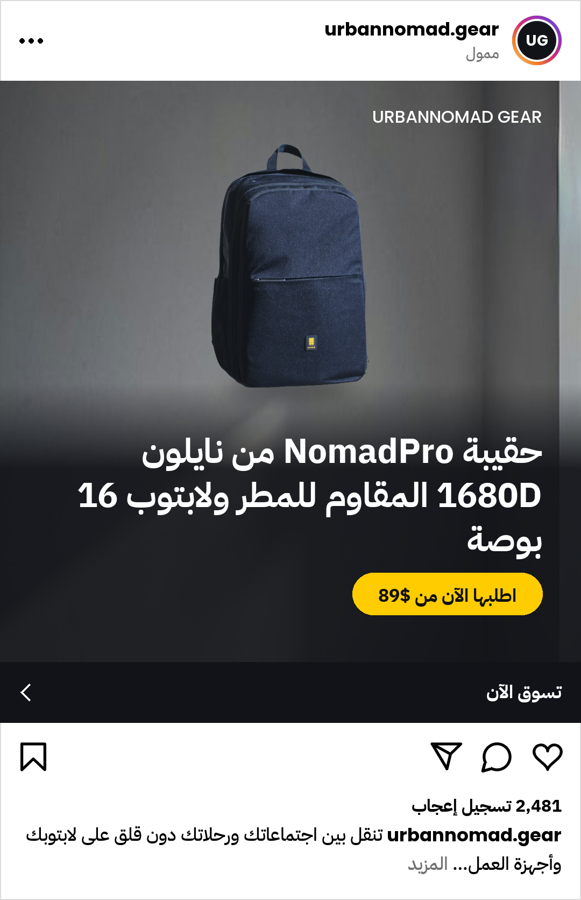

# AI Ad Generator

**A product catalog in, ready-to-publish ad campaigns out.** A Python workflow that reads
`products_master.xlsx`, looks at each product photo with a multimodal LLM, writes native ad
copy (English, Arabic, French, Spanish, German), and renders feed, story, carousel and
Instagram-preview images in the brand's colours, saved under `output/{Brand}/{Product}/`.
A Streamlit dashboard does the same for one product at a time, with a live preview, brand
editing, regenerate and a `.zip` export.

**Walkthrough video (3–5 min):** _link to be added_

<p>
  
  &nbsp;
  
</p>

*Two of the generated ads in the Instagram preview: English (#13) and Arabic (#23, right-to-left).
The `output/` folder holds all 10 demo campaigns from a real run.*

---

## Quick start

Python 3.11 or newer (built and tested on Python 3.13, Windows 11).

```bash
python -m venv .venv
.venv\Scripts\activate              # macOS / Linux: source .venv/bin/activate
pip install -r requirements.txt
copy .env.example .env              # macOS / Linux: cp .env.example .env
```

Put a free key in `.env`:

| Setting | Where to get it | Needed? |
|---|---|---|
| `LLM_API_KEY` | Gemini, free tier: <https://aistudio.google.com/apikey> | recommended |
| `FALLBACK_API_KEY` | OpenRouter, free models: <https://openrouter.ai/keys> | optional backup |

With no key at all, everything still runs, using template copy and brand-colour backgrounds.

### Run

```bash
python main.py                      # the 10 demo products (English, Arabic, French)
python main.py --ids 13 23          # chosen product IDs, in this order
python main.py --all                # all 30 products
python main.py --offline            # no network: cached answers, otherwise templates
python main.py --refresh            # ignore cached AI answers (spends requests)
streamlit run app.py                # the dashboard
pytest                              # the tests: no network, no quota (about 2 minutes)
```

The first run downloads the background-removal model once (about 170 MB). After that, a
rerun replays AI answers from `.cache/`: a 2-product rerun went from 204 s to 7 s with zero
API calls.

---

## What it makes for each product

```
output/{Brand}/{Product}/
├── copy.json                 2 A/B copy angles, carousel cards, 4 platform captions + hashtags
├── creative_feed.png         1080×1080, angle A (pain point)
├── creative_feed_b.png       1080×1080, angle B (emotional)
├── creative_story.png        1080×1920 (bottom kept clear for the app's buttons)
├── carousel_slide_1..N.png   1080×1080, 3–5 cards: hook → features → CTA
├── mockup_instagram.png      feed ad A inside a realistic Instagram post
└── metadata.json             how it was made: brand used, vision findings, models,
                              prompt versions, tokens, cost, timings, fallbacks, warnings
```

Every ad has a **headline, hook, primary text, 3 bullets and a CTA**, written in the
product's language (not translated from English), plus captions for **Instagram, TikTok,
Facebook and LinkedIn**, each following that platform's length, emoji and hashtag habits.

## How it works

```
 products_master.xlsx ─► excel_loader ─► Product
 config/brands/*.json|yaml, brand PDF, dashboard edits ─► brand_manager ─► BrandProfile
 product photo ─► vision_agent (LLM call 1: type, colours, materials, selling points,
                                photo checks, a scene prompt)
              ─► copy_engine  (LLM call 2: both angles, carousel, captions, as JSON)
              ─► visual_engine: cut the product out (local model) ─► AI background scene
                                ─► layout + text in brand colours ─► all images + mockup
              ─► output_writer ─► output/{Brand}/{Product}/
```

`core/pipeline.py` runs these steps. The CLI (`main.py`) and the dashboard (`app.py`) call the
same pipeline, so they can't behave differently. A product costs **2 LLM calls + 1 image
request**.

## The dashboard

`streamlit run app.py`

- **Product:** any of the 30 products (the 10 demo products first).
- **Photo:** the catalog photo, an **AI-generated photo**, an upload, or an image link.
- **Brand:** see and edit the voice, colours, target market and language, or upload a
  **brand-guidelines PDF**: the LLM reads the voice, colours and market from it (try
  `data/sample_brand_guidelines.pdf`).
- **Generate / New angle:** one click makes the ad. *New angle* asks for a different hook and
  headline; the last 5 variants stay, so you can compare them and pick one.
- **Preview:** the product photo side by side with feed A and B, the story, every carousel
  card, the Instagram preview, the captions with hashtags, and the cost and details tab.
  Arabic is shown right-to-left.
- **Export:** *Save to output/* writes the chosen variant; *Download .zip* gives the same files.
- **Protection:** the buttons are locked while an ad is being made (no double clicks), and at
  most **5 new AI ads per 10 minutes** can be made, to protect the free daily quota. Answers
  replayed from the cache are free and don't count.

## The brief, point by point

| Brief | Where |
|---|---|
| Read `products_master.xlsx` (or `.csv`) | `core/excel_loader.py` (falls back to the `.csv`; a bad row is reported and skipped) |
| Product imagery: reference photo, AI-generated, upload or link | `core/image_source.py`, `core/pipeline.py`, the dashboard's photo options |
| LLM looks at the image and the features | `core/vision_agent.py`: Gemini sees the photo; its findings go into the copy prompt and the scene prompt |
| Copy in the product's language: primary text, hook/headline, bullets, CTA | `core/copy_engine.py`, `config/prompt_templates/` (one writing guide per language) |
| Feed 1080×1080, story 1080×1920, carousel | `core/visual_engine.py` |
| Captions with emojis, line breaks and hashtags | `copy.json → captions` (4 platforms) |
| The output folder structure | `core/output_writer.py` |
| Brand profile from a JSON or YAML file | `config/brands/`, `config/brand_sample.json`, `core/brand_manager.py` |
| Brand kit PDF, read by the LLM | `core/brand_manager.py` (`patch_from_pdf`) + the dashboard |
| Dashboard: selector, image input, preview, RTL, brand controls, regenerate, `.zip` | `app.py` (drawing only) + `core/dashboard.py` (the logic, tested without a browser) |
| 10 products, 2+ languages, 2+ formats | `python main.py`: 10 products, English + Arabic + French, 4 formats |
| **Bonus:** carousel creator, A/B variants, cost tracker, social mockup | all four: 3–5 cards; pain point vs emotional; tokens and cost per call and per product; Instagram preview |

## Design choices

Each one is written up with the alternatives rejected in [`docs/decisions/`](docs/decisions/README.md).

1. **The real product, an AI background** ([ADR-001](docs/decisions/001-hybrid-product-visuals.md)).
   The product in the ad is the real photo, cut out; only the scene behind it is AI-painted.
   An image model drawing the product changes its shape and details, and an ad that shows a
   different product misleads buyers. An AI-painted product photo is still offered (the brief
   asks for it), but it is labelled *check that it shows the real product before publishing*.
2. **Free tiers only, and ready for them to run out**
   ([ADR-003](docs/decisions/003-llm-model-selection.md)). Gemini for vision and copy (two
   models, so two daily quotas), OpenRouter's free models as the backup. Daily-quota errors
   skip that model at once instead of retrying; per-minute limits wait and retry. All answers
   are cached, so reruns are free.
3. **Structured output.** Every LLM answer is JSON checked against a Pydantic schema; an
   invalid answer gets one repair request with the error in it.
4. **It never stops.** Every external step has a fallback: template copy, a gradient
   background, the framed photo if the cut-out fails. Each fallback is written to
   `metadata.json` and shown in the CLI and the dashboard; nothing degrades silently.
5. **Copy that isn't generic.** Each headline must use a fact from the catalog or the photo;
   banned clichés per language ("Elevate your…", "Game-changer"…); Arabic written for the
   Gulf market, in Modern Standard Arabic with a light Gulf flavour
   ([ADR-006](docs/decisions/006-arabic-register.md)). A **price fact-check** flags any price
   that isn't in the catalog: prompt rules alone didn't stop invented prices.
6. **Brand and image awareness.** The brand comes from, in order: the catalog row → a brand
   config file → the brand PDF → the dashboard edits; missing colours are taken from the
   product photo. The vision step also checks the photo: about 2 out of 3 catalog photos show
   a different item or another brand's product (a Chanel bottle for an oud perfume), and the
   ad then carries a warning.
7. **Arabic done properly.** Letters are joined and laid out right-to-left inside the images
   (with the line direction forced, so a line that starts with a Latin word like "NomadPro"
   still reads right-to-left), the dashboard shows Arabic right-to-left, and the Instagram
   preview is mirrored the way an Arabic phone shows it.

## The demo run

`python main.py` on the 10 demo products (4 English, 4 Arabic, 2 French), live on the free
tiers: **10/10 products made**, 20 LLM calls (18 live, 2 from cache), 46,743 tokens, **$0
actual cost**. What the run asked a human to check, rather than hiding:

- 3 catalog photos show another brand's logo (IWC, LEVELS, Ferragamo): the ad is fine, the
  photo needs replacing before publishing;
- 1 headline compares against a "$5,000 Swiss price tag", a price that isn't in the catalog;
- 3 cut-outs came apart (the slip-ons, the sunglasses' thin frame, the yoga mat), so the framed
  photo was used instead.

**Tests:** 462 automated tests (`pytest`), written before the code they test (TDD), with
fake AI services: no network, no quota. Each fix was checked by breaking the code on purpose
and watching the right test fail. Every edge case found is listed in
[`docs/edge-cases.md`](docs/edge-cases.md).

## Project structure

```
ai-ad-generator/
├── main.py                  CLI: batch over the catalog
├── app.py                   Streamlit dashboard (drawing only)
├── core/
│   ├── excel_loader.py      catalog → products
│   ├── brand_manager.py     brand profile: catalog → config → PDF → manual edits
│   ├── image_source.py      catalog photo, upload, link, brand logo
│   ├── vision_agent.py      LLM call 1: what the photo shows
│   ├── copy_engine.py       LLM call 2: the copy, plus the price and cliché checks
│   ├── scene_generator.py   AI backgrounds (Pollinations) and AI product photos, gradient fallback
│   ├── visual_engine.py     cut-out, layout, text: feed, story, carousel
│   ├── mockup.py            the Instagram preview
│   ├── text_render.py       fonts, Arabic shaping and right-to-left, fitting text into a box
│   ├── llm_client.py        one client for Gemini and OpenRouter: retries, quotas, JSON repair, cost
│   ├── cache.py             on-disk cache of AI answers
│   ├── output_writer.py     the output folder and the .zip
│   ├── pipeline.py          runs the steps for one product or a batch
│   ├── dashboard.py         the dashboard's logic, rate limiter included
│   ├── prompts.py           loads the versioned prompt files
│   └── schemas.py           the data contracts (Pydantic)
├── config/
│   ├── settings.py          reads .env
│   ├── brand_sample.json    the brief's brand profile example
│   ├── brands/              brand configs, matched by brand name
│   └── prompt_templates/    versioned prompts + one writing guide per language
├── assets/fonts/            Poppins + IBM Plex Sans Arabic (open licence)
├── data/                    products_master.xlsx / .csv, a sample brand PDF
├── product_images/          the 30 reference photos
├── output/                  the 10 demo campaigns
├── docs/                    spec, design, decisions, edge cases, AI usage log
└── tests/                   pytest
```

## Configuration

Everything lives in `.env` (see [`.env.example`](.env.example)); no model name or key is hard-coded.

| Setting | Default | What it does |
|---|---|---|
| `VISION_MODEL`, `COPY_MODEL` | `gemini-3.5-flash-lite`, `gemini-3.5-flash` | the two Gemini models (two daily quotas) |
| `LLM_FALLBACK_MODELS` | other Gemini models | tried next, on the same key |
| `FALLBACK_MODELS` | 3 OpenRouter `:free` models | the backup provider, in order |
| `IMAGE_PROVIDER` | `pollinations` | AI backgrounds (free, no key); `none` = gradients |
| `MAX_REQUESTS_PER_MIN` | `10` | stays under the free tiers' per-minute limits |
| `REFERENCE_INPUT/OUTPUT_PRICE_PER_MTOK` | `1.50` / `9.00` | the paid price used for the cost estimate (USD per 1M tokens) |

## Known limits

- **Free tiers change.** Gemini's free tier allowed 20 requests a day per model when this was
  built. When everything is used up, the run finishes with cached answers and templates, and
  says so.
- **The catalog photos are reference only:** many show another item or brand. The system warns
  about it; for a real campaign, upload the right photo or use the AI-generated one (and check it).
- **Pollinations is free but slow on purpose:** about 16 s between images, so a new product
  takes 30–50 s. Cached products take seconds.
- **French, Spanish and German copy** follows the same rules and checks, but no native speaker
  has reviewed it.
- **The cost estimate** uses one reference price (Gemini 3.5 Flash's list price) for every call,
  so it's an upper bound for the cheaper vision model. The actual cost on free tiers is $0.
- **The rate limit** is kept in the dashboard server's memory: shared by every tab, reset when
  the server restarts. It's a quota guard, not user accounts.

## Documentation

- [`docs/spec.md`](docs/spec.md): the requirements (FR / NFR) and how each is accepted
- [`docs/design.md`](docs/design.md): architecture, data contracts, prompts, error handling, caching
- [`docs/decisions/`](docs/decisions/README.md): the architecture decisions, with the options rejected
- [`docs/edge-cases.md`](docs/edge-cases.md): every edge case tested and the test that proves it (in Arabic)
- [`docs/ai-usage-log.md`](docs/ai-usage-log.md): how AI was used on this project

## How AI was used

I designed and led this project, and used an AI coding agent (Claude Code) as the implementer.
I owned the requirements, the decisions and the verification; the agent wrote the code to my
spec, test-first. The [AI usage log](docs/ai-usage-log.md) records what I asked for, what it
proposed, and what I decided or corrected, including the cases where its first answer was wrong.
